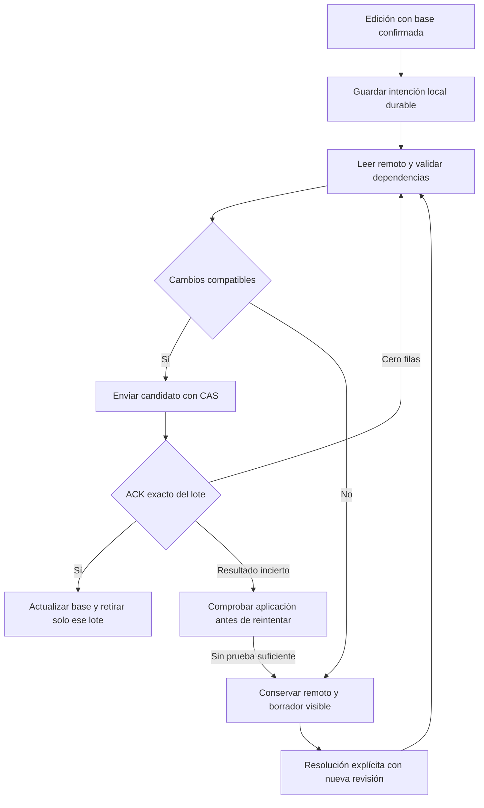

# FIN04 fase 2: conservar ediciones de recibos y deudas entre dos dispositivos

**Estado: DESIGN_ONLY_AWAIT_CLAUDE_REVIEW. Propuesta sin implementar ni ejecutar pruebas de producto.**

Base inspeccionada: **4.26.161, `13e814d2289b279c80f325125e8168570b3a1d35`**. Encargo `96ddc7251e8190f33cbcc5051b7160944d54e0b2`, claim propio `11e31cc351fdf532d2896883a8370ca9547f38a7`, ACK `f2a3ca571d34bf9038c7c431f67da89fc25cf21e`. Los anuncios de beta162/163 no cambian esta base. Fuentes, pruebas y PR anteriores permanecen intactas.

La recomendación es conservar una base confirmada y un registro local durable de intenciones, comparar cada edición con esa base y con la última lectura remota, y enviar el resultado mediante el CAS existente. Los campos independientes pueden combinarse; las operaciones relacionadas con dinero, calendario, confirmación o borrado se validan completas. Un conflicto conserva el valor confirmado y el borrador pendiente, sin resolverlo por el reloj del teléfono.

Ejemplo: A llama «Internet casa» a un recibo de **4237 céntimos** y B cambia su día del 25 al 27. Con las dependencias sin cambios, ambos deben acabar con «Internet casa», día 27 y 4237 céntimos. Si B cambia el importe mientras A confirma un cargo de 4237, no se debe fabricar un recibo con el importe nuevo y una prueba de pago incompatible.

## 1. Evidencia y alcance de las afirmaciones

Hay tres niveles distintos:

| Nivel | Qué acredita | Límite |
|---|---|---|
| Lectura de esta entrega | Código exacto beta161, writers, revisiones, efectos y dependencias citados abajo | No se ha ejecutado ese código en esta tarea |
| Investigación anterior | Beta149 `408d8d3484568e1c02fa25dcd2df30ad71477bf1`, 11 escenarios, 6 RED y 5 controles históricos | No son resultados sobre beta161 ni pruebas nuevas |
| Diseño y matriz de este documento | Contrato propuesto, resultados esperados y pasos para futuras pruebas | Todas las filas de la matriz son **NO EJECUTADAS**; las candidatas RED aún deben reproducirse |

El informe histórico `outputs/fin04-informe.md`, líneas 17–41, y `work/fin04-20261019/analysis.json` documentan `debt-independent`: nombre A perdido y cuota remota conservada en **10129**, principal **120023**; `receipt-independent-v2`: nombre A perdido, día 27 conservado, importe **4237**. `cas-control-v2` conserva el rechazo de la escritura atrasada. `money-oracles.json` conserva además el gasto testigo **1234**, identidad y cardinalidad. Sus escenarios UI no partían necesariamente de la misma revisión: el control CAS separado sí. No trasladar el número de RED ni la cronología de esos escenarios a beta161.

FIN04 fase 1 aborda renombrado/nota de Gastos y ACK por identidad. Su brief incluido en beta161 declara expresamente fuera de alcance la convergencia general de recibos/deudas (`docs/briefs/fin04-fase1-renombrar-nota.md:80`). Se usa como compatibilidad, sin reabrir PR286 ni PR43. No se afirma un estado actual de esas PR a partir de informes antiguos.

## 2. Qué hace beta161, según su fuente

Las referencias son rutas y líneas del checkout exacto. `fin04-phase2-source-inventory.json` aporta SHA256, blob Git y extractos numerados; el paquete incluye las fuentes consultadas.

| Referencia | Lectura verificable e implicación |
|---|---|
| `00-core.js:1198–1230` | `pullState` lee `data,updated_at`. `pushState` valida titular, usa UPDATE por `user_id` y `updated_at`, devuelve conflicto ante cero filas; sin revisión hace upsert. La revisión enviada nace de `new Date().toISOString()` en el cliente. No hay comprobación explícita de exactamente una fila en esta función. |
| `11-app-main.js:438–447` | `pushAppState` retiene el payload enviado y la revisión esperada; solo adopta el ACK si sigue el mismo usuario y revisión. El ACK alimenta hoy la base privada de Metas. |
| `11-app-main.js:674–764` | El pull elige el estado general entero por `_savedAt`; login fresco adopta nube. Hay uniones específicas para gastos, Metas, lápidas, recibos borrados, vetos e históricos, pero no un merge general por campo de `fixed`/`debts`. |
| `11-app-main.js:1220–1254,1652–1659` | Guardado diferido 1200 ms y reentrada online; conflicto provoca aviso y pull. Los errores capturados no crean por sí solos un borrador de recibos/deudas recuperable. Todos los caminos hacia el mismo `app_state` deben pasar por un único coordinador de escritura. |
| `00-core.js:4061–4192` | Metas ya mantiene base local, merge de tres vías por grupos y borradores. Es referencia de patrón, no algoritmo reutilizable sin cambios: retiene solo tres conflictos y sus reglas de eliminación/finanzas son específicas de Metas. |
| `00-core.js:4194–4205,1604–1611` | `slimForCloud` excluye gastos, extracto y `_goalSync`; el backup excluye `_goalSync` explícitamente. Cualquier nuevo metadato privado debe excluirse también de ambos, exportaciones y Hogar, sin hacer viajar borradores. |
| `09-tab-debts-goals.js:25–87,119–158` | El editor de deuda valida contra objeto fresco local. Cuota, amortización, día, plazo, valor, ancla y estado pueden cambiar juntos. «Cambios guardados» confirma el estado local, no el ACK de nube. |
| `09-tab-debts-goals.js:316–407` | Altas, borrado sin pagos vinculados, liquidación, archivo y amortización tienen writers separados. Amortizar ajusta valor y a veces plazo/balloon/settledAt; no crea en esta función un movimiento bancario. No interpretar su acción como un segundo débito de efectivo. |
| `14-v4-screens.js:631–648,816–837,846–847,971–990` | Recibos tiene borrar/deshacer, guardado de importe, metadatos en cada edición y altas. El modo sencillo también escribe cuotas mediante `patchDebtFields`. No basta intervenir en el editor avanzado. |
| `08-motor-bank.js:4153–4207,4245–4255` | `patchFixedById` cambia campos, elimina calendario incompatible, conserva/transforma pruebas válidas al renombrar y recalcula `paidYm/paidDay/wait`. `patchDebtFields` puede eliminar `amort`. Un merge de propiedades sin esas reglas cambiaría dinero. |
| `08-motor-bank.js:165–206,357–388,390–426,428–487` | Nombre, categoría, banco, importe y candidatos intervienen en la atribución de un cargo. `paymentProofs` vincula identidad/modelo/mes; un cargo no puede pagar dos recibos. Un nombre de recibo no es siempre metadato inocuo. |
| `08-motor-bank.js:492–515` | La cuota exige identidad, importe exacto en céntimos, categoría, fecha y evidencia; vincular no reancla principal. El saldo proyectado por calendario no equivale a un pago confirmado. |
| `08-motor-bank.js:2111–2212` | Borrar un recibo cambia `fixed`, lápida, marcas de gastos del periodo y, cuando corresponde, anclas de saldo; envía después escrituras de gastos separadas. Deshacer mantiene ID. Los meses cerrados conservan las marcas. No hay una transacción conjunta demostrada entre `app_state` y `expenses`. |
| `13-hogar.js:19–64,132–140`; `00-core.js:1904–1914` | Hogar publica un resumen por `household_id,user_id`. Dos móviles con el mismo usuario compiten por su estado; la pareja con otro usuario conserva otro estado. Este diseño no añade edición de datos ajenos. |
| `supabase/migrations/0001_init.sql:31–58` | Declaración local: PK `user_id`, `data jsonb`, `updated_at timestamptz`, política propia con USING/WITH CHECK. No se ha comprobado su despliegue. La búsqueda en migraciones no encontró un trigger que convierta `updated_at` en una revisión monotónica de `app_state`. |

**Riesgo adicional estático:** dos escrituras pueden generar el mismo sello de milisegundo, y el camino sin revisión usa upsert. Por ello «CAS existente» no basta para prometer ausencia universal de ABA ni creación concurrente segura. Son riesgos inferidos del código, con controles propuestos abajo, no fallos reproducidos aquí.

## 3. Alternativas y decisión propuesta

| Alternativa | Ventaja | Coste o fallo relevante | Decisión |
|---|---|---|---|
| Mantener LWW y añadir aviso | Cambio pequeño | Sigue perdiendo ediciones independientes y borradores | Insuficiente |
| PATCH de cada propiedad | Parece simple | `fixed/debts` están dentro de un blob; tampoco protege dependencias ni evita una escritura antigua del blob completo | No adoptarla como solución aislada |
| Tres vías por propiedades | Combina nombre/nota independientes | Puede mezclar cuota, plazo, ancla y pago de contratos incompatibles | Usarla solo con grupos y validación de dependencias |
| Intenciones + tres vías + CAS | Expresa renombrar, cambiar contrato, amortizar, borrar y deshacer; conserva pendiente | Requiere base, cola durable, ACK correcto y UI de conflictos | **Recomendada, por etapas** |
| Registro servidor de operaciones y transacciones | Puede dar idempotencia y atomicidad entre tablas | Cambio de servidor, migración y compatibilidad de escritores | Necesario si se exige la garantía completa descrita en §7; propuesto, no ejecutado |

Primera etapa propuesta: ediciones idempotentes y fusiones claramente independientes; conservar intenciones financieras conflictivas o de resultado incierto para revisión, sin reaplicarlas automáticamente. Segunda etapa, solo con contrato aprobado: operaciones financieras durables con prueba de aplicación e integración entre tablas. No llamar «convergencia completa» a la primera etapa.

## 4. Tabla de campos, grupos y conflictos

`B` es base confirmada, `L` intención local y `R` estado remoto fresco del mismo titular. Comparar presencia y tipo: ausente, null, cadena vacía y cero no son intercambiables. Conservar campos desconocidos; si una intención puede afectarlos y no se conoce su semántica, conflicto recuperable. No convertir ni redondear datos históricos para facilitar la comparación.

| Entidad / campos actuales | Unidad propuesta | Cuándo combinar | Cuándo detener y conservar borrador |
|---|---|---|---|
| Identidad: owner, tipo `fixed/debts`, `id`; banco/cuenta/referencias de cargos | Identidad inmutable | Dos IDs distintos, salvo recursos financieros compartidos | ID duplicado, dueño diferente, ID ausente o reasignación implícita. Nunca emparejar por nombre/importe |
| Deuda `name`, `note`, presentación desconocida | Asignación de un campo | Cambio disjunto con contrato intacto; revalidar efectos de reconocimiento de cuotas | Mismo campo con valores distintos; nombre coincidente con otra obligación que cambie atribución. La nota de la deuda no es la nota de Gastos |
| Recibo `note` y metadatos sin uso financiero probado | Asignación de un campo | R no cambió ese campo y dependencias conservadas | Misma nota distinta, tipo desconocido o base ausente. No añadir editor de nota por arrastre si hoy no existe |
| Recibo `name`, `category` | Renombrar/reclasificar con conjunto de lecturas | Cambios disjuntos que preserven contrato, prueba válida y unicidad del cargo; nombre+día sin evidencia puede pasar | Prueba nueva/eliminada, modelo legacy que necesitaría transformarse, cambio de candidatos o conflicto del mismo nombre. Revalidar sin rescatar una prueba ya inválida |
| Recibo `amount`, `bankAmount`, `account`, `freq`, `months`, `schedule[{m,amt,day}]`, `day` | Contrato de cargos completo | Nombre/nota independiente solo tras validar; no unir dos contratos concurrentes por defecto | Importe frente periodicidad/fecha/cuenta; dos meses editados dentro de schedule se tratan inicialmente como un grupo, no como índices del array |
| Recibo `paidYm`, `paidDay`, `wait` | Estado calendario condicionado al contrato/periodo | Solo mediante intención validada con evidencia y fecha; nunca OR de flags | Pago/confirmación frente cambio de contrato o mes. `wait` no prueba que un cargo no exista en otro móvil |
| `paymentProofs[ym]` y sus identidad/modelo/nombre ligado | Registro completo por periodo + dependencia global de cargo | Periodos independientes con identidades distintas, contrato compatible y sin reutilizar cargo en otro recibo/deuda/puntual | Dos pruebas distintas del mismo periodo, un cargo en dos destinos/meses, link frente unlink/veto, importe/cuenta/frecuencia cambiados |
| Deuda `value`, `asOf`, `monthly`, `amort`, `months`, `balloon`, `day`, `apr`, `account` | Contrato/proyección atómica | Metadatos independientes. Evaluar siempre saldo, cuota y plazo juntos | Dos cambios financieros aunque sean propiedades distintas; cambio de día que cruce cuota; TAE desconocida no se convierte en cero |
| Deuda `original`, `downPayment`, `startMonth`, `ent` y campos de inicio heredados | Contexto histórico de solo lectura para la intención | Se copian íntegros; solo los writers expresamente autorizados podrían cambiarlos | Nunca reescribir originales al rebasar. `startDay` posterior a esta base se considera campo desconocido protegido, no se incorpora FIN12/163 |
| Deuda `settledAt`, `archivedAt` | Liquidar/archivar/restaurar visibilidad con precondiciones | Nota/nombre si saldo y estado siguen válidos | Archivar frente amortizar/corregir saldo; saldo proyectado 0 no inventa confirmación; no borrar pagos históricos |
| Amortización | Intención con ID, importe exacto, principal previo, fecha, contrato y resultado esperado | Una sola aplicación acreditada. Metadatos disjuntos pueden conservarse | Doble envío, ACK incierto, otra amortización o cuota/contrato cambiado: no restar de nuevo ni limitar silenciosamente al saldo nuevo |
| Borrar/deshacer recibo, `reciboBorrado`, `reciboBorradoAt`, marcas y anclas | Una intención con efectos en varias entidades/tablas | Solo con revisión fresca, plan de efectos completo y confirmación del usuario | Borrar frente editar/pagar; deshacer tras nueva edición/borrado. La lápida vigente impide resurrección; el borrador se conserva aparte |
| Borrar deuda | Intención de ciclo de vida | Sin cambios concurrentes ni pagos vinculados, con lectura de vínculos fiable | Pago nuevo, feed parcial, edición concurrente o ausencia no demostrada. Una ausencia del array no acredita un borrado intencionado |
| `cuotaNo`, `cuotaAlias`, `reciboNo/At`, `deleted/At`, `obAbsorbed*`, campos source y signo FIN19 | Contratos existentes, fuera del merge genérico | Se mantienen sus writers y uniones; se leen como dependencias | Nunca sumar, limpiar o convertir marcas por parecidos de nombre/importe; cargo y devolución conservan signos y tipos |

La unidad de independencia es la intención y su conjunto de dependencias, no solo «el otro campo tiene otro nombre». Dos entidades distintas pueden competir por el mismo cargo o cuenta anclada. Cambiar una nota de D1 no debe quedar bloqueado por un conflicto de nombre en D2; cambiar un pago que depende de D2 sí.

## 5. Algoritmo propuesto y estados observables

### Captura y persistencia local

1. Tras lectura válida del mismo titular, guardar una base de las entidades y dependencias necesarias ligada a la revisión exacta. Conservar el documento remoto necesario para reconstruir el próximo envío sin sustituir arrays ajenos por copias antiguas. No iniciar merge sobre un pull parcial/inválido ni tratar «no legible» como «vacío».
2. Al editar, generar `intentId` aleatorio estable por acción, `owner`, `entityKind/id`, generación local, revisión base, before/after, presencia/tipos de campos, conjunto de lectura/escritura, instante civil de la decisión y precondiciones de negocio. Un reenvío conserva el ID; una nueva decisión explícita recibe otro ID. El reloj no decide quién gana.
3. Guardar base + cola + borradores en una partición local propuesta `_planSync`, separada por usuario y modo pruebas, antes de anunciar «guardado en este dispositivo». Leer de vuelta la persistencia. Si falla cuota de almacenamiento, conservar editor abierto y avisar; el fallback en memoria no acredita durabilidad. No almacenar extractos enteros ni perfiles en el borrador. Si no cabe otra intención, bloquear el nuevo guardado conservando las anteriores; nunca truncar silenciosamente a tres registros como el helper de Metas.
4. Los campos desconocidos sobreviven por copia del estado remoto. Para bases legacy ausentes, ofrecer revisión contra estado remoto y conservar local; no inferir cambios del usuario a partir de `_savedAt` o diferencia entre dos snapshots sin base común.

### Fusión y escritura

5. Cola por titular con **un solo envío de app_state en vuelo**, compartida por debounce, reconexión, guardado manual y demás escritores de ese documento. Mantener orden por entidad y dependencias, pero permitir otras entidades no dependientes cuando una intención está apartada. Agrupar un lote inmutable con IDs y generaciones; no capturar `stateRef` cambiante como si fuera el payload enviado.
6. Para cada grupo: si `L=B`, tomar R; si `R=B`, aplicar L; si `L=R`, la asignación ya coincide y no se duplica; si ambos difieren entre sí y de B, registrar conflicto. Esto permite reconocer una **asignación** satisfecha, pero no prueba la aplicación de una **amortización**. Revalidar también todas las dependencias leídas, aunque no se escriban. Una eliminación usa intención/tombstone, no el resultado de un array incompleto.
7. Construir candidato desde el remoto fresco y las intenciones aceptadas, componiendo las uniones existentes de Metas, reservas, gastos/lápidas, recibos y FIN19 en un único lugar. Si otra capa devuelve `cloudOnly` o invalida una dependencia, no reinstalar a continuación un contrato local de deuda incompatible. Los normalizadores de arranque también son writers: sus cambios no se deben atribuir a una edición humana.
8. Validar IDs únicos, propietario, céntimos, moneda, periodos, cuotas/plazos y exclusividad de cargos sobre el **estado final conjunto**, incluidas otras obligaciones. No usar tolerancias nuevas. No ejecutar funciones con efectos de red al calcular el candidato. Las confirmaciones que cambien la proyección al pasar el día/mes se vuelven a presentar; no reinterpretar a medianoche una amortización aprobada ayer.
9. Enviar una única escritura CAS contra la revisión de R. Cero filas significa «no confirmado», nunca éxito ni permiso para upsert. Leer remoto, clasificar conflicto/ausencia/no acceso y volver al paso 6 conservando intención. Sin revisión inicial: leer primero; si no existe fila, alta que falle ante colisión en vez de upsert ciego. Un estado remoto inválido se aparta y no se sobrescribe por recuperación automática.
10. ACK válido: exactamente una representación de la fila esperada, propietario, revisión nueva válida y correlación con el lote enviado; exigir los datos necesarios en el futuro contrato de respuesta. El resultado `{unchanged:true}` del cache solo sirve si acredita el mismo payload confirmado y sus IDs; no puede consumir una intención nueva por igualdad superficial. Respuestas vacías, duplicadas, sin revisión o de otra sesión quedan pendientes.
11. La base posterior al ACK es **el payload confirmado**, no el estado actual que puede contener una edición posterior. Consumir solo IDs/generaciones del lote; conservar lo editado durante el vuelo. Ignorar ACK/fallos de sesiones, revisiones o generaciones obsoletas. Serializar también pulls: una respuesta anterior no puede hacer retroceder la base de un ACK más nuevo.

### Error, conflicto y recuperación

12. Conflicto de negocio: el documento compartido conserva el grupo remoto completo; el local conserva un borrador de la intención y los tres valores. Se pueden publicar grupos independientes de ese borrador solo si sus dependencias no incluyen el grupo conflictivo. Ambos clientes sin intenciones pendientes convergen al remoto tras pull/reload. El cliente con borrador muestra además su pendiente claramente separado; no se promete que los borradores privados aparezcan en ambos móviles.
13. Error de transporte: mantener «pendiente». Propuesta de política: como máximo tres intentos consecutivos por intención dentro de actividad de la app, con pausa creciente; luego apartarla, persistir contador y aviso único. Offline/sesión ausente no consume una ráfaga de intentos. Montar, recargar u online no rearma el contador apartado. La cifra tres es una propuesta coherente con FIN04 fase1, pendiente de revisión.
14. Timeout tras posible commit: leer antes de reintentar. Asignaciones idempotentes pueden satisfacerse por valor y precondiciones. Operaciones financieras necesitan una prueba durable de su ID de operación; si no existe, marcar **resultado por comprobar**. No restar otra vez ni inferir «ya hecha» porque otro móvil dejó el mismo saldo. Reintentar manualmente una operación incierta primero intenta resolverla; no crea otra amortización a ciegas.
15. Al resolver un conflicto, comparar de nuevo con revisión y dependencias frescas. «Usar mi cambio» crea una nueva intención explícita sobre el remoto, mostrando saldo/cuota/plazo resultantes antes de confirmar. Si vuelve a cambiar la base, volver a revisar. «Conservar el actual» elimina solo ese borrador tras persistir la decisión; «Más tarde» lo conserva. Nada resucita un recibo borrado salvo un deshacer expresamente validado.
16. Al cambiar de usuario, desactivar colas y respuestas anteriores. No publicar borradores en Hogar, backups de nube, logs o telemetría. Al cerrar la app solo se acredita la cola local durable; no se promete ejecución de fondo. Al volver, leer remoto y reconciliar antes de escribir.

## 6. Dinero, invariantes y cruces entre entidades

- Importes de los oráculos son enteros con signo en céntimos; no se derivan llamando al motor que se prueba. La conversión de entrada nueva debe exigir precisión válida. Conservar valores originales y tipos legacy byte a byte salvo los campos de la intención aprobada. `null` TAE significa desconocida; no cambiarlo a 0.
- El principal es absoluto; no sumar dos principales ni usar promedios. Cambiar cuota puede cambiar `amort`, plazo y `value`; conservar el grupo validado. Una amortización de 12345 sobre 120023 produce **107678** una sola vez; no cambia automáticamente efectivo ni crea una compra.
- Una cuota o prueba bancaria no autoriza a descontar de nuevo un saldo que ya la incluye. No convertir saldo proyectado 0 en «pagado». El cargo de prueba de **4237** mantiene ID, importe, source, signo y banco/cuenta; cambiar solo nombre no lo duplica ni lo modifica.
- La identidad incluye dueño/tipo/ID. Para pagos, preservar banco, cuenta conocida, referencia, ordinal y periodo. Si falta cuenta, no inventarla ni asumir que dos referencias iguales pertenecen a la misma cuenta. Tipos/signos FIN19 y absorciones quedan fuera de normalizaciones genéricas: testigo +1234 y devolución -234 suman **1000**, con dos filas conservadas.
- Borrar/deshacer un recibo debe conservar la semántica actual del periodo: un cargo de **6237** que deja de estar excluido hace pasar el gasto del periodo de **4000 a 10237**, sin cambiar el saldo mostrado por el mero borrado y sin alterar los meses cerrados. No es una simple operación de array: marcar como completa solo tras comprobar también las escrituras de vínculos necesarias.
- Un pull completo de `app_state` no prueba ausencia de vínculos en `expenses` ni de pagos bancarios locales. Para borrar deuda con lectura incompleta, retener intención. Los índices de exclusividad de pagos deben abarcar recibos, deudas y puntuales; la cola de entidades distintas no evita ese conflicto por sí sola.

## 7. ¿Se puede evitar un cambio de esquema?

**Sí para una primera etapa acotada**, porque `app_state.data` ya es JSON y la base/cola puede ser privada. Las fusiones de asignaciones, la conservación de conflictos y las comprobaciones del ACK pueden diseñarse sin columnas nuevas. Esto cambia el contrato del cliente y su almacenamiento local; no equivale a «ningún cambio de formato». No resuelve por sí solo todos los escritores antiguos ni operaciones financieras entre tablas.

Para ejecutar automáticamente intenciones financieras, un registro propuesto `planApplied` dentro del JSON podría guardar `intentId`, resultado, versión del contrato y tombstones del mismo commit CAS. Es una alternativa sin DDL, pero **solo es segura si todos los escritores conservan sus metadatos y la revisión no se reutiliza**. Un writer antiguo puede borrar ese registro al subir su blob. No usar una cola local ni un valor final coincidente como sustituto de un recibo servidor. No podar IDs por edad sin horizonte de clientes y mecanismo que rechace clientes anteriores al corte; al alcanzar un límite, bloquear nuevas operaciones conservando las existentes.

Para una garantía completa y compatible con coexistencia, la propuesta mínima a revisar es:

1. **Revisión monotónica de servidor.** Se podría seguir usando la columna `updated_at` si un mecanismo servidor asegura un valor estrictamente posterior al anterior y devuelve ese valor. Es un cambio de lógica servidor/migración aunque no añada columna. Un contador dedicado es otra opción. Un generador cliente monotónico no protege frente a un cliente viejo que escriba otro sello ni sustituye validación de precisión de timestamptz. No afirmar ABA resuelto por `Date.now()` o un UUID local.
2. **Idempotencia y efectos múltiples.** Para pagos, borrados y deshacer que crucen `app_state`/`expenses`, operación servidor con CAS + ID de intención único por titular + validación + cambios en una transacción. Un registro durable de resultados sería el cambio de esquema mínimo si el JSON no permite retención/compatibilidad fiables. Debe respetar la identidad bancaria, el aislamiento y las guardas existentes, sin privilegios ampliados por comodidad. No hay SQL ni API implementados en esta entrega.
3. **Escritores antiguos.** Exigir versión/capacidad en el punto servidor que acepta writes, o limitar expresamente la garantía a clientes compatibles. Una bandera local o un aviso de actualizar no impide que un móvil offline antiguo sobrescriba mañana. Conservar backups y pendientes para recuperación; rollback de interfaz no debe reactivar LWW sobre operaciones nuevas.

Recomendación para Claude: aprobar primero el contrato y la etapa acotada; decidir explícitamente si se desea la garantía completa. Si se mantiene la prohibición de servidor, dejar las operaciones ambiguas como pendientes por comprobar y declarar esa limitación en aceptación. No presentar ese límite como una tarea de producto ya realizada.

## 8. Plan de pruebas deterministas: propuestas NO EJECUTADAS

Preparación futura: dos contextos aislados A/B, mismo usuario sintético U, SDK del SHA aprobado y transporte compartido controlable. Fijar Madrid a **20/10/2026 12:00 local**, ambos con `R0 = 2026-10-20T10:00:00.000Z` y misma base antes de editar. Esperar arranque y guardado real; pausar explícitamente cada petición, sin sleeps que decidan el orden. R1/R2 son revisiones nuevas devueltas por el almacén, no tiempos locales elegidos por el test. Cada fila se repite en orden inverso cuando aplique, como variante prevista, no como reintento de un fallo.

Fixtures monetarias: F mensual=4237, día25, sin prueba salvo indicación. D principal=120023, cuota=10011, ancla del mes actual, día28, sin plazo/amort/balloon salvo indicación; así no se descuenta una cuota por calendario en estos casos. Gasto testigo=1234 y devolución testigo=-234 separados, neto1000. Además de la cifra esperada, comparar todos los campos ajenos, IDs, cantidad de filas, arrays completos y particiones locales. «A=B=R» se refiere al dato confirmado tras pull y reload; el borrador pendiente privado se aserta por separado.

| ID / tipo | Revisión inicial, acciones y orden controlado | Oráculo esperado de persistencia y clientes | Qué detecta |
|---|---|---|---|
| P01 RED candidato | R0; A renombra D, B cuota10011→10129; B ACK R1, A CAS0, pull y rebase R2 | A=B=R nombreA/cuota10129/principal120023; gasto1234 intacto; sin borrador perdido | Pérdida histórica de edición independiente; causal beta161 pendiente |
| P02 RED candidato | R0; A nombreF, B día25→27; B R1, A CAS0 y rebase | A=B=R nombreA/día27/importe4237, una entidad, sin pagos inventados | LWW del recibo |
| P03 conflicto | R0; A nombreA de D, B nombreB; B R1 | A=B=R nombreB, cuota10011/principal120023; borradorA durable; elegir A produce R2 | Mismo campo no se resuelve por reloj |
| P04 control | R0; A y B asignan el mismo nombre | Un valor, ninguna intención duplicada; importes4237/120023 constantes | Asignación idempotente |
| P05 conflicto | R0; A F.amount=4500, B cambia freq/meses; B R1 | Contrato B completo confirmado, borrador A4500; nunca mezclar importeA con frecuenciaB automáticamente | Dependencia entre campos diferentes |
| P06 conflicto | R0; schedule F de dos cargos4237 y4311; A cambia primero a4500, B segundo a4400; B R1 | Total anual confirmado8637, borradorA; no afirmar8900 hasta decisión explícita y validada | Arrays schedule tratados como contrato, no por índice |
| P07 control condicionado | R0; A renombra F con prueba BOOK válida4237, B nota descriptiva; B R1 | NombreA+notaB, prueba conserva identidad/modelo válido, un pago4237, sin tocar cargo | Rename no destruye prueba válida; probar también legacy/modelVersion2 |
| P08 conflicto dinero | R0; A confirma cargo4237 para F, B importe4500 o cuenta distinta; B R1 | F4500/cuentaB, cargo4237 íntegro sin nueva prueba aceptada; intención de A visible para revisar | No trasladar prueba a contrato diferente |
| P09 conflicto global | R0; F1/F2 distintos ambos4237; A vincula cargoX a F1, B a F2; A R1 | Solo una atribución de X; B pendiente; gastoX una fila4237. Sin sumar8474 como pagos | Dos entidades comparten recurso |
| P10 control por periodo | R0; A pruebaOct=X4237, B pruebaNov=Y4237, noviembre ya válido, identidades distintas; B R1 | Dos pruebas históricas, total de cargos8474, una por mes; misma identidadX en ambos meses debe fallar | Merge por claves con exclusividad intermensual |
| P11 conflicto | R0; D financiero cambia en B mientras A amortiza12345; B R1 | ContratoB completo; amortizaciónA no reaplicada; pendiente hasta reconfirmar contra nuevo saldo | No unir cuota/plazo con amortización vieja |
| P12 ACK perdido | R0; A amortiza12345; servidor aplica R1 y corta respuesta; reload y reenvío mismo ID | Con recibo durable: saldo107678 exactamente, una aplicación. Sin recibo: estado107678 remoto y pendiente «por comprobar», cero segunda resta | No obtener95333 por retry |
| P13 dos operaciones | R0; A12345 y B10001 IDs distintos; A R1, B conflicto | Antes de resolver:107678 y B pendiente10001. Tras nueva confirmación de B:97677; cero movimientos de efectivo creados | No confundir dos amortizaciones con retry ni aplicarlas a ciegas |
| P14 mismo importe distinto ID | R0; A12345 y B12345; A R1 | Segunda queda pendiente. Si se confirman dos operaciones reales:95333, dos IDs; si era el mismo acto:107678 | No deduplicar por cantidad o resultado final |
| P15 cuota/plazo | R0 varianteD saldo100001, amort/cuota10000,11 cuotas pendientes; A9000, B otro plazo; B R1 | GrupoB íntegro; A pendiente. Si se aprueba9000/12:11×9000+1001=100001, nunca principal perdido | Última cuota de1 céntimo en base; cuota/plazo atómicos |
| P16 lifecycle | R0 variante saldo proyectado0 pero sin settledAt; A archiva, B corrige saldo1 | Archivo no puede aceptarse automáticamente; principal confirmado1; nada marca pago bancario | 0 proyectado no prueba liquidación |
| P17 borrar/editar | R0; A borraF con cargo6237 del periodo, B renombra copia; A R1 | F ausente, lápida vigente; B borrador recuperable sin resurrección; gasto4000→10237; saldo mostrado constante; cierre anterior intacto | Respetar lápidas y efectos contables |
| P18 deshacer | R1 borrado anterior; A deshace, B nueva edición/borrado concurrente R2 | Conflicto antes de restaurar. Deshacer aprobado fresco conserva mismoID y devuelve gasto10237→4000 sin duplicar cargo6237 | Undo no es alta nueva |
| P19 borrar deuda/pago | R0; A quiere borrarD, B vincula cuota10011 a D antes de A | Con lectura válida del vínculo: no borrarD; cargo10011 e ID conservados. Con lectura parcial: pendiente, tampoco borrar | Ausencia no demostrada / cruce de tablas |
| P20 cero filas/ACK inválido | R0; entregar0, vacío,>1 filas, revisión ausente o usuario distinto | Ningún caso marca sincronizado ni consume intención. R conserva4237/120023; retry tras lectura | NoACK no es éxito; distinguir404/RLS/ausencia sin inventar causa |
| P21 edición durante vuelo | R0; enviar nombreA, editar a nombreC antes de ACK R1; luego fallo/ACK antiguo | Base=payloadA confirmado; intenciónC permanece; despuésR2 nombreC; cantidades intactas | ACK exacto al lote, no al state actual |
| P22 pull desordenado | PullP0 empieza enR0; writeACK R1 y otro pullR1 terminan; llegaP0 | No retroceder aR0, no resucitar ni limpiar pendientes;4237/120023 íntegros | Epoch/generación de lectura y escritura |
| P23 dos entidades/cola | R0; D1 conflicto permanente tres veces, D2 nota independiente y F nombre | D1 borrador+contador; D2 y F sincronizan sin tocar dinero; reload/online no rearma D1 | Evitar bloqueo de cola y spam |
| P24 offline/almacenamiento | R0; A offline edita; B escribeR1; cerrar/reabrir A; variante falla persistencia local | Con persistencia: intención/base sobreviven y se rebasan. Sin ella: no mensaje durable, editor conserva borrador visible | Promesas de guardado reales |
| P25 ABA/revisión | R0; forzar dos writes con sello igual, reloj atrasado y sello ya usado | Guardián futuro rechaza/revisa; nunca dos ACK de actualización que dejen reutilizable la misma revisión | RED propuesto de contrato de revisión; no ejecutado |
| P26 alta concurrente/legacy | Sin fila: A y B intentan crear; variante base local ausente y remoto no vacío | Una creación; el otro lee y conserva intención, sin upsert que borre el remoto. Base ausente no se infiere por reloj | Primer guardado y actualización desde cliente antiguo |
| P27 aislamiento | A=U, B=V en mismo Hogar; cambiar sesión de A con write en vuelo | Dos app_state; ambos recibos4237 y principales120023 propios. Ninguna cola/ACK/draft deU entra enV; Hogar solo resumen | Propiedad y privacidad |
| P28 FIN19/regresión | R0; editar notaF con gasto+1234/devolución-234, referencias/cuentas distintas y campos unknown | Neto1000, dos filas, signos/tipos/UUID/source/metadata byte iguales; no nuevos asientos | No normalizar dinero ajeno al merge |
| P29 medianoche | R0; abrir confirmación antes de00:00Madrid y enviar después, verano/invierno/fin de año | Se revalida periodo/proyección, cambia aviso si cambió resultado; sin pago ni amortización adicional; cargos originales intactos | No reutilizar confirmación anterior al cambio civil |
| P30 writer antiguo | R0; nuevo publica intención, viejo escribe blob sin metadatos y luego vuelve el nuevo | Modo acotado detecta incompatibilidad/conserva borrador; garantía completa exige rechazo servidor del writer viejo | La capacidad local no garantiza coexistencia segura |
| P31 fallo entre tablas | R0; borrar6237 o link cuota10011; interrumpir después de app_state y antes de expenses, y al revés | No «sincronizado» hasta convergencia comprobada; preservar historial, cargo único y pendiente durable. Variante transaccional futura: todo o nada | Límite de atomicidad actual, ningún falso éxito |

Para P01/P02 el fallo histórico guía el guion, pero el primer paso de una futura implementación será reproducir su RED en la base que Claude autorice entonces. P03–P31 incluyen controles y nuevos contratos: no se presupone que todos fallen hoy. No adaptar el esperado al comportamiento existente para obtener verde.

### Guion reproducible y aceptación futura

1. Sembrar A/B desde la misma base y R0; auditar `before`, requests, `affectedRows`, respuesta, store remoto, estado visible y almacenamiento local. Mantener un testigo ajeno por entidad y cuenta.
2. Ejecutar acciones por la UI real de Recibos y Deudas (normal y sencilla). Usar métodos de producción directos solo para aislar respuestas imposibles en UI, etiquetándolos como controles de protocolo.
3. Detener ambos envíos, liberar el orden declarado, producir conflicto, pull y decisión de cola. Tras cada paso comparar contra enteros de esta matriz; después navegar fuera/volver, recargar A y B y publicar/leer snapshot Hogar cuando corresponda.
4. Mutantes propuestos: volver al LWW general, elegir `_savedAt` como árbitro, unir propiedades financieras sueltas, aceptar0 filas, limpiar toda cola ante ACK, reutilizar revisión, sumar dos principales, repetir amortización, borrar tombstones, ignorar otro recibo candidato, perder signo, usar misma partición para dos dueños, truncar conflictos, reaplicar desde backup. Cada mutante debe romper un oráculo concreto; **ninguno ejecutado aquí**.
5. Registrar specs y tests nuevos en los runners cuando se implemente. Reusar sin repetir por inercia evidencias históricas, pero ejecutar sobre el SHA nuevo los afectados: `goals-three-way`, `recibos-bajas-y-union`, `recibos-renombrar`, `recibos-book-rival`, `debt-payment-state`, `deudas-*`, FIN04 nota/cola, sandbox y polaridad/identidad FIN19. La lista es plan, no una tabla de verdes.
6. Tras GO de diseño: caracterización RED, implementación mínima en tarea nueva, revisión independiente financiera, gates exactos de código/documentación/tamaño/catálogo/privacidad, CI, integración de Claude, artefacto servido y dos móviles. Sin ampliar caps ni VERSION por este documento. Si entra servidor, otro alcance con entorno aislado, permisos reales y pruebas transaccionales. CPU6 solo con concesión específica posterior si resulta necesario; no se ha medido rendimiento.

## 9. Pantallas y texto propuesto

| Superficie | Cambio propuesto y señal visible |
|---|---|
| Plan → Recibos, ficha, alta, importe/nombre/calendario | «Guardado en este dispositivo · Pendiente de sincronizar» hasta ACK. Tras ACK: «Sincronizado». No cerrar el único lugar que conserva el borrador antes de persistirlo. Conservar navegación, foco, teclado y cierre existentes. |
| Plan → Deudas, editor avanzado, liquidar/archivar y asesor de amortización | Mostrar resultado completo de la intención: saldo, cuota, plazo y pago final. Amortización pendiente no puede presentarse como pago bancario confirmado. |
| Recibos → Cuotas en modo sencillo | Mismo protocolo y estado que Deudas; no dejar un writer que siga sobrescribiendo el grupo por fuera. |
| Conflicto recuperable en ficha/lista | Indicador «Hay un cambio por revisar». Panel: «Este recibo cambió en otro dispositivo. Hemos conservado tu cambio para que puedas revisarlo». Columnas «Valor actual» / «Tu cambio» y, si ayuda, «Cuando lo editaste». Acciones «Conservar el actual», «Revisar mi cambio», «Más tarde». |
| Conflicto financiero | «Ha cambiado el importe, el calendario o la confirmación de pago. Revisa la operación antes de aplicarla». Mostrar valores concretos; ninguna selección preactivada que aplique dinero. Si ya fue borrado: «Se eliminó en otro dispositivo. Tu cambio sigue guardado aquí». |
| Error persistente / ACK incierto | «No hemos podido confirmar la sincronización. Tu cambio sigue guardado en este dispositivo». Acción «Comprobar y reintentar». Para dinero incierto, comprobar primero; no ofrecer un botón que duplique la operación. |
| Inicio, Plan/resumen, Cartera, Gastos vinculados | Derivados recalculados desde la misma versión efectiva. Con pendiente local, indicarlo junto al resumen afectado; no mezclar principal remoto con plazo local. No duplicar cargo ni alterar su histórico. |
| Hogar y Ajustes/sincronización | Mantener agregados propios. Propuesta conservadora: publicar valores confirmados; si hay pendiente financiero, avisar de que no se ha incluido en la foto compartida. Lista accesible de pendientes privados del titular, sin exponerlos a la pareja. |

Todos los textos deberán traducirse a es/en/ca cuando exista implementación. Usar componentes propios, sin alert/confirm nativos; avisos persistentes accesibles, foco de retorno y anuncio una vez por intención. No mostrar CAS, UUID, revisión ni códigos técnicos al usuario. La hora del móvil no se presenta como prueba de quién editó primero.

## 10. Riesgos, compatibilidad y entrega por etapas

Prioridad alta: pérdida de intención en un pull, duplicación de amortización al perder ACK, una misma prueba en dos obligaciones, writer antiguo que borre metadatos y operaciones entre dos tablas a medias. Los escenarios P08–P14/P20–P22/P25/P30–P31 son condiciones de aceptación, no ampliaciones tácitas de alcance.

Riesgos de integración: Metas puede pedir adoptar nube; reservas, FIN19 y cierre mensual modifican estado de forma legítima; el nuevo merge no puede deshacerlos. Las pruebas de borrado deben incluir cuentas simuladas y anclas legítimas: no imponer igualdad de apertura de una cuenta que debe cambiar de mes, pero sí igualdad exacta de saldo mostrado cuando el contrato lo exige. Comparar antes/después con oráculos específicos, nunca un `JSON.stringify` global usado como único criterio financiero.

Riesgos operativos: almacenamiento lleno, crecimiento de bases/recibos de operaciones, pestañas múltiples del mismo dispositivo, pulls retrasados, migración y restauración de backup. Una cola solo en memoria no sirve. Proponer límites explícitos que detengan nuevas acciones sin borrar las antiguas; no modificar caps actuales para acomodar el diseño. Referencias y memo deben conservarse en caminos sin cambios; no serializar todo el histórico por pulsación. El coste real queda pendiente de medir con fuente implementada.

Secuencia propuesta: (A) cerrar decisiones de esta revisión; (B) reproducir y fijar el contrato de revisión/ACK; (C) base y cola durable sin pérdida, UI pendiente/conflicto y merges idempotentes; (D) dinero/operaciones múltiples solo con idempotencia y atomicidad acordadas; (E) convivencia/actualización y aceptación real. Cada tramo requiere encargo exacto; este documento no los inicia.

## 11. Preguntas concretas para revisión de Claude y, después, del propietario

1. Si en los dos móviles se cambia el mismo dato y los valores son distintos, ¿debe pedirse elegir cuál conservar? Recomendación: sí; hasta elegir, conservar el valor confirmado y el borrador local. La hora de cada móvil no debe decidir cuál gana.
2. ¿Los borradores privados y los cambios que necesitan una decisión deben verse también en el otro móvil, o basta guardarlos en el móvil donde se hicieron? Mostrarlos en ambos requiere enviarlos entre dispositivos y decidir cuánto tiempo se conservan y cómo se protege su privacidad. La propuesta inicial los guarda solo en el móvil donde se hicieron.
3. Si un móvil borra un elemento y el otro lo edita, ¿debe mantenerse el borrado confirmado y ofrecer recuperar el borrador de forma expresa? Recomendación: sí, para que el elemento no reaparezca sin avisar; si tiene pagos vinculados, revisarlos antes de borrar.
4. Si se registran dos amortizaciones a la vez, ¿deben contarse como dos operaciones solo después de confirmarlas expresamente? Recomendación: sí; que tengan el mismo importe no demuestra que sean la misma operación. Reducir el capital de la deuda tampoco demuestra que se haya hecho un pago bancario.
5. ¿Empezamos sin cambiar el servidor, dejando para revisión las operaciones de dinero cuyo guardado no se pueda confirmar, o exigimos desde el principio que el servidor garantice que un reintento no repita una operación y que todos sus cambios se guarden juntos, sin dejar una parte a medias? Esta decisión determina los cambios mínimos del servidor y de la estructura de datos descritos en §7.
6. Si un móvil tiene una versión antigua, también cuando vuelve después de estar sin conexión, ¿debe actualizarse antes de guardar nuevos cambios, o se le permite seguir guardando aunque no podamos garantizar que ambos móviles acaben conservando las mismas ediciones? Recomendación para poder garantizarlo: exigir en el servidor que el móvil entienda las reglas nuevas y conservar sus borradores mientras se actualiza.
7. Mientras haya cambios de dinero pendientes, ¿deben mostrarse en Hogar solo los importes confirmados? Recomendación: sí, con un aviso visible de que falta actualizar la información compartida; sin publicar borradores ni modificar datos del otro titular.
8. Si falla tres veces el guardado de un cambio, ¿debe apartarse de los reintentos automáticos y avisar una sola vez, manteniéndolo en una lista de pendientes accesible desde la ficha y desde sincronización? Hay que aprobar ese límite antes de implementarlo.

Estas preguntas se entregan a Claude; no se ha contactado al propietario ni pedido un permiso general. **No se ha implementado, probado, compilado, desplegado ni abierto/modificado ninguna PR en esta fase. No se ha adquirido runner, puerto o lease.**
